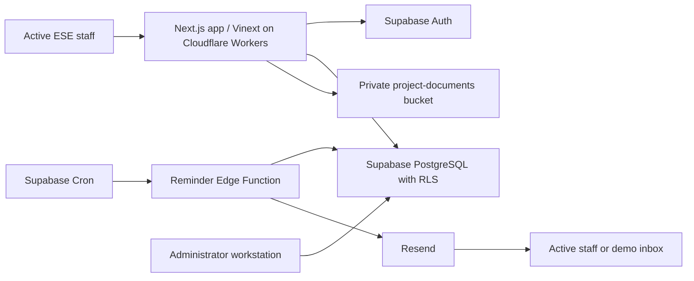
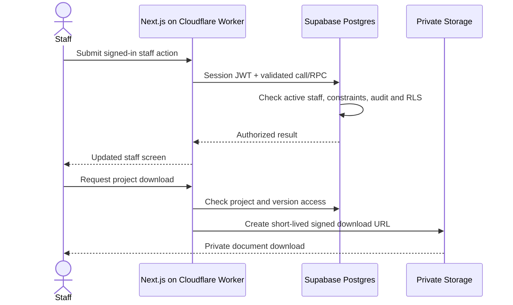

# Architecture

## Runtime and trust boundaries

- **Browser:** renders the staff interface and uses the Supabase publishable key with the authenticated session. It receives no service-role credential.
- **Next.js server actions:** validate form input, require an authenticated active staff record, use the session-bound Supabase client, and rely on database policies/RPC checks for authorization. Browser visibility is not an authorization boundary.
- **Supabase PostgreSQL:** owns record integrity, archival, audit history, completion gates, immutable preset snapshots and document versions, deadline state, and reminder delivery deduplication. RLS is enabled across application tables. Active staff manage operational records; staff provisioning and service operations remain privileged.
- **Supabase Storage:** keeps project documents private. Uploads use generated immutable version paths; download requests are authorized and use short-lived signed URLs. Replacing a file creates another version rather than overwriting the stored object.
- **Cloudflare Workers:** required host for the staff web application, built with Vinext/Vite from `cloudflare.config.ts` and `vite.config.ts`. The Cloudflare deploy step is separate from Supabase migrations and reminder scheduling.
- **Supabase Cron and Edge Function:** Cron invokes the POST-only reminder handler every five minutes. Preview is the default. Sending requires a server-held bearer secret, service-role key, Resend API key and explicit delivery enablement.
- **Resend:** sends immutable, idempotent requests. Demo mode redirects all recipients to `revisa@rpi.edu`; live mode is opt-in and limited to active ESE staff selected for a deadline.
- **Tracker import:** runs offline from an administrator workstation. A service-role key is used only in that process. Source row identity and workbook checksum support retry without collapsing repeated project numbers or addresses.

## Data invariants

- Existing client IDs remain `bigint`; new domain IDs are UUIDs. Store calendar deadlines as dates and audit events as UTC timestamps.
- Archive clients and operational records to preserve links and history. Call follow-ups append; deletion leaves a tombstone with actor/time. Audit records are not user-editable.
- A client can have many projects; project and task staff assignment use join tables. Preset application copies a definition snapshot, tasks, and requirements so later preset edits affect future applications only.
- Imported historical completion is retained as an unverified claim. Current completion requires all required intake answers, tasks, verified signed-document requirements, and live project deadlines.
- Documents are immutable versions in private storage. Verification points to one available version in the same project. Archiving/replacing evidence invalidates affected verification and can reopen completion/deadline state.
- Each deadline has independent recipients, editable advance offsets, revision, and a signed-document requirement. A unique delivery occurrence key, lease token, immutable payload, attempt ledger, retry schedule, and provider idempotency key prevent duplicate sends and unsafe retry after uncertain outcomes.

## Request paths

Reminder processing is asynchronous and does not run in a staff request. It computes the current applicable stage in the America/New_York office clock, snapshots the email request in the database, leases a small batch, rechecks deadline/recipient eligibility, and records each provider result. After downtime it sends the most urgent currently applicable stage instead of replaying every missed stage. Quota deferrals and ambiguous outcomes are retained for review.

## Code map

- `app/(staff)/` contains staff pages; `app/actions/` contains server actions.
- `lib/supabase/` creates browser/server clients and verifies active staff; `lib/features/` contains domain queries and helpers.
- `supabase/migrations/` is the ordered database source of truth. `supabase/functions/` contains the reminder dispatcher and shared email/scheduling modules.
- `scripts/prepare_import.py` extracts a private ignored payload; `scripts/import_tracker.mjs` validates it and performs a dry run unless `--apply` is set; `scripts/verify_database.mjs` runs the local PGlite harness.
- `cloudflare.config.ts` and `vite.config.ts` define the Worker build. `package.json` keeps local Next development separate from Cloudflare Worker commands.

See [schema-contract.md](schema-contract.md) for fields, RPCs, migration rules, and import behavior. Local PGlite tests use stubs and do not prove policies in a live Supabase project.
